<div align="center">

# Racha

**Hábitos desde el reloj.**

App para **Wear OS**: marcas una actividad cumplida, ganas puntos, subes de nivel y mantienes
una racha de días seguidos. Además usa el contador de pasos del reloj para saber si estás
caminando o corriendo, y marca sola la caminata del día.


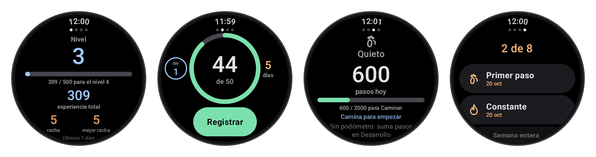

*Progreso · Hoy · Pasos · Logros, capturadas en el emulador Wear OS Large Round.*

</div>

Todo corre en el reloj: no necesita internet, cuentas ni celular. El progreso se guarda con
DataStore y sigue ahí al cerrar la app.

Proyecto final de **Diseño de Interfaces de Software**.

## Contenido

- [Funciones](#funciones)
- [Cómo se usa](#cómo-se-usa)
- [Pantallas](#pantallas)
- [Reglas del juego](#reglas-del-juego)
- [Cómo ejecutarlo](#cómo-ejecutarlo)
- [Opciones de desarrollo](#opciones-de-desarrollo)
- [Decisiones de diseño](#decisiones-de-diseño)
- [Estructura](#estructura)

## Funciones

- **Registro de hábitos**: siete actividades con puntos, en un solo toque.
- **Niveles y experiencia**: cada punto suma a la experiencia total.
- **Racha diaria** con bono de puntos desde el tercer día.
- **Meta diaria** de 50 puntos, con anillo de progreso.
- **Ocho logros** con pantalla de celebración.
- **Pasos en vivo**: muestra los pasos de hoy y si estás quieto, caminando o corriendo.
- **Registro automático** de *Caminar 20 min* al llegar a la meta de pasos.
- **Vibraciones distintas** para registrar, cumplir la meta y desbloquear un logro.

## Tecnologías

| | |
|---|---|
| Lenguaje | Kotlin |
| Plataforma | Wear OS (API 30 o superior) |
| Interfaz | Jetpack Compose para Wear OS |
| Datos | DataStore Preferences + kotlinx.serialization |
| Sensores | Contador de pasos (`TYPE_STEP_COUNTER`) y vibración |

## Cómo se usa

Así se ve registrar un hábito, desde que abres la app hasta que vuelves a Hoy. Son dos toques.

<table>
  <tr>
    <td align="center" width="25%">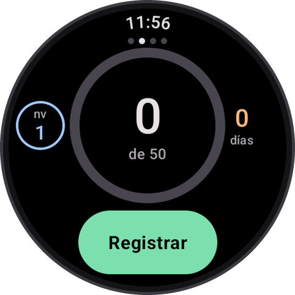<br><b>1. Hoy</b><br><sub>Al empezar el día el anillo está vacío. Tocas <i>Registrar</i>.</sub></td>
    <td align="center" width="25%">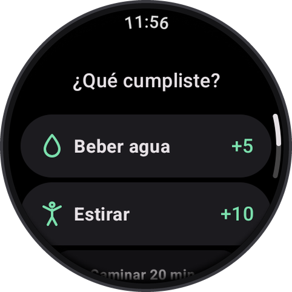<br><b>2. ¿Qué cumpliste?</b><br><sub>Eliges la actividad. Cada una muestra sus puntos.</sub></td>
    <td align="center" width="25%">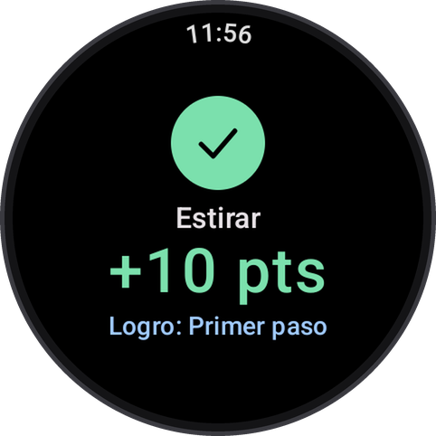<br><b>3. Confirmación</b><br><sub>Palomita, puntos ganados y un toque de vibración.</sub></td>
    <td align="center" width="25%">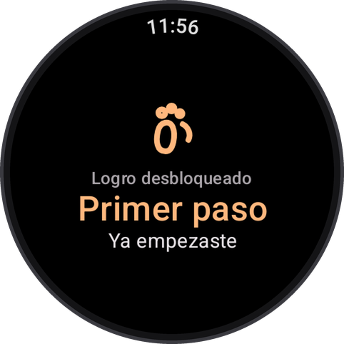<br><b>4. Logro</b><br><sub>Si desbloqueaste un logro, se celebra antes de volver a Hoy.</sub></td>
  </tr>
</table>

Con varios días seguidos, la racha empieza a dar puntos extra y el anillo se llena más rápido:

<table>
  <tr>
    <td align="center" width="33%">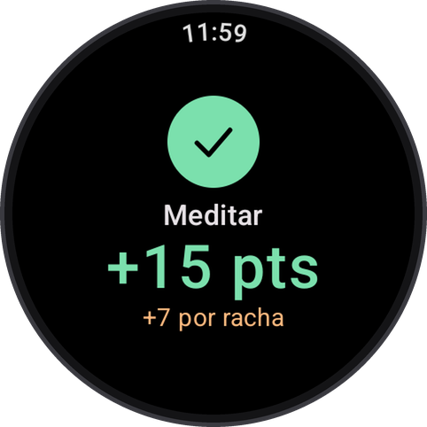<br><b>Bono de racha</b><br><sub>Con 5 días, <i>Meditar</i> da 15 puntos y 7 más por la racha.</sub></td>
    <td align="center" width="33%">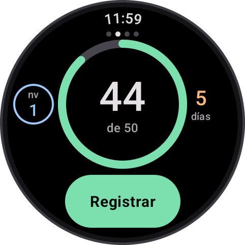<br><b>Cerca de la meta</b><br><sub>44 de 50 puntos y una racha de 5 días.</sub></td>
    <td align="center" width="33%">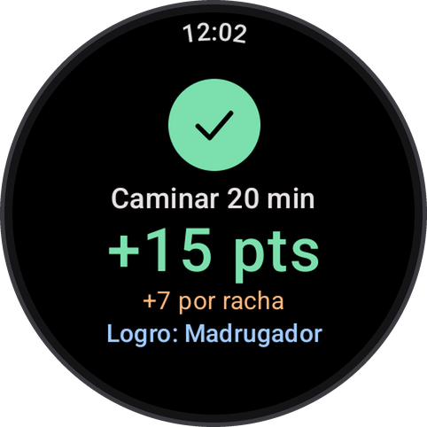<br><b>Caminar, sola</b><br><sub>Al llegar a la meta de pasos, la caminata se registra sin tocar nada.</sub></td>
  </tr>
</table>

## Pantallas

Las pantallas principales son páginas horizontales: **Progreso ← Hoy → Pasos → Logros**. La
app abre en Hoy, y para volver atrás se desliza desde el borde izquierdo.

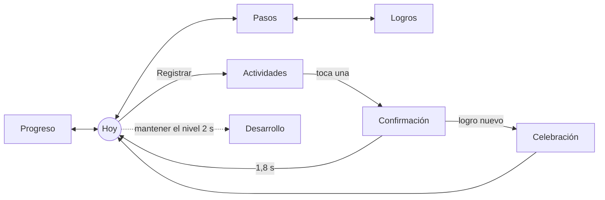

<table>
  <tr>
    <td align="center"><br><b>Hoy</b></td>
    <td>Anillo con los puntos del día contra la meta de 50. A la izquierda el nivel y a la derecha la racha. Abajo, el único botón: <i>Registrar</i>.</td>
  </tr>
  <tr>
    <td align="center">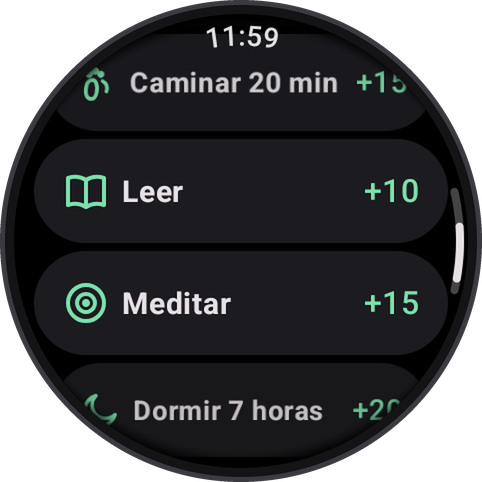<br><b>Actividades</b></td>
    <td>Las siete actividades en una lista que sigue la curva de la pantalla: lo del centro se ve grande y lo de los bordes se encoge. Las cumplidas hoy aparecen atenuadas y con palomita.</td>
  </tr>
  <tr>
    <td align="center"><br><b>Confirmación</b></td>
    <td>Palomita, actividad y puntos ganados, más el bono de racha y el logro si los hay. Vuelve sola a Hoy en 1,8 s.</td>
  </tr>
  <tr>
    <td align="center">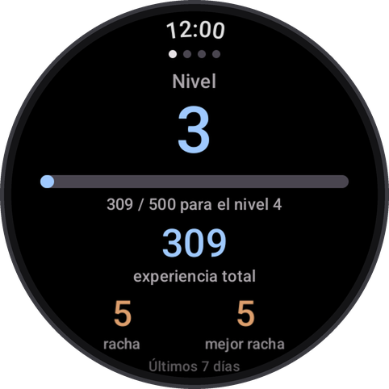<br><b>Progreso</b></td>
    <td>Nivel actual, barra hacia el siguiente, experiencia total, racha y mejor racha.</td>
  </tr>
  <tr>
    <td align="center">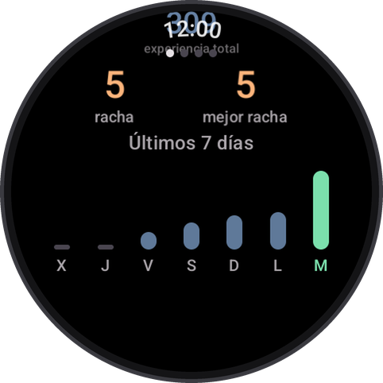<br><b>Progreso: semana</b></td>
    <td>Más abajo, los puntos de los últimos 7 días en barras. El día de hoy va resaltado en menta.</td>
  </tr>
  <tr>
    <td align="center">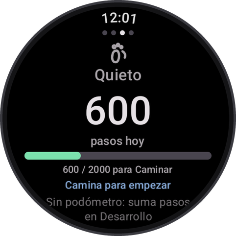<br><b>Pasos</b></td>
    <td>Pasos de hoy, estado (quieto, caminando o corriendo) y avance hacia el registro automático de <i>Caminar</i>. En el emulador avisa que no hay podómetro y que se pueden sumar pasos en Desarrollo.</td>
  </tr>
  <tr>
    <td align="center">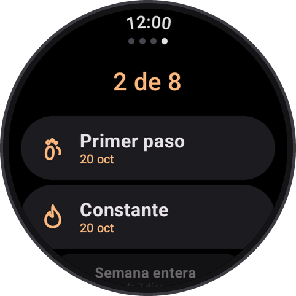<br><b>Logros</b></td>
    <td>Los ocho logros y cuántos llevas. Los desbloqueados se ven en ámbar con su fecha; los pendientes, en gris con su condición.</td>
  </tr>
  <tr>
    <td align="center"><br><b>Celebración</b></td>
    <td>El logro recién desbloqueado, con tres vibraciones ascendentes. Se cierra sola o con un toque.</td>
  </tr>
</table>

## Reglas del juego

**Puntos.** Cada actividad tiene un valor fijo:

| Actividad | Puntos |
|---|---|
| Beber agua | 5 |
| Estirar | 10 |
| Caminar 20 min | 15 |
| Leer | 10 |
| Meditar | 15 |
| Dormir 7 horas | 20 |
| Entrenar | 25 |

**Niveles.** El nivel N pide `50 × N × (N + 1) / 2` puntos acumulados: el 2 pide 150, el 3
pide 300, el 4 pide 500 y así. Se empieza en el nivel 1.

**Racha.** Cuenta los días seguidos con al menos una actividad. Al registrar, si la última
actividad fue ayer la racha sube uno, si fue hoy se queda igual y si fue antes vuelve a 1.
Cuando pasa un día entero sin actividad, Hoy muestra 0 hasta que registres otra vez.

**Bono de racha.** Desde el día 3 de racha, cada actividad da 10 % extra por cada día de
racha, con un tope del 50 %. Por ejemplo, con 5 días *Caminar* da "+15 pts" y "+7 por racha".

**Meta diaria.** 50 puntos. Al alcanzarla el reloj vibra dos veces.

**Pasos.** Con 2000 pasos en el día, *Caminar 20 min* se registra sola. El estado se calcula
con el ritmo de los últimos segundos: menos de 40 pasos/min es *Quieto*, desde 40 es
*Caminando* y desde 135 es *Corriendo*.

**Logros.**

| Logro | Condición |
|---|---|
| Primer paso | Cumplir la primera actividad |
| Constante | Racha de 3 días |
| Semana entera | Racha de 7 días |
| Imparable | Racha de 30 días |
| Subiendo | Llegar al nivel 5 |
| Veterano | Llegar al nivel 10 |
| Día completo | Cumplir todas las actividades en un día |
| Madrugador | Cumplir una actividad antes de las 7 a. m. |

## Cómo ejecutarlo

### En el emulador

1. Abre esta carpeta en Android Studio (*File → Open*).
2. Crea un emulador en *Device Manager → Create Virtual Device → Wear OS* (por ejemplo
   *Wear OS Large Round*, API 30 o superior).
3. Elige la configuración `app` y pulsa *Run*.

El emulador no tiene podómetro real: para probar los pasos usa *Sumar 100 pasos* en las
opciones de desarrollo.

### En un reloj real

Sirve cualquier reloj con Wear OS 3 o superior, por ejemplo un Samsung Galaxy Watch 4 o más
reciente. No sirven el Apple Watch ni los Galaxy Watch con Tizen.

1. En el reloj, activa las opciones de desarrollador: *Ajustes → Acerca del reloj →
   Información de software* y toca siete veces *Versión de software*.
2. En *Opciones de desarrollador*, activa *Depuración ADB* y *Depuración inalámbrica*.
3. Conecta el reloj y la computadora a la misma red Wi-Fi.
4. En el reloj, toca *Emparejar nuevo dispositivo*. En Android Studio, abre el menú de
   dispositivos, elige *Pair Devices Using Wi-Fi* y escribe el código que muestra el reloj.
5. Elige el reloj como dispositivo y pulsa *Run*.
6. Al abrir la app, acepta el permiso de **actividad física** para que cuente los pasos.

Una vez instalada, la app se queda en el reloj y funciona sin la computadora.

### Desde la terminal

```
gradlew assembleDebug        compila el APK
gradlew testDebugUnitTest    ejecuta las pruebas de la lógica
```

La salida de compilación queda en `C:\gradle-builds\racha` y no en la carpeta del proyecto,
porque OneDrive choca con los miles de archivos temporales de Gradle (está configurado en
`settings.gradle.kts`).

## Opciones de desarrollo

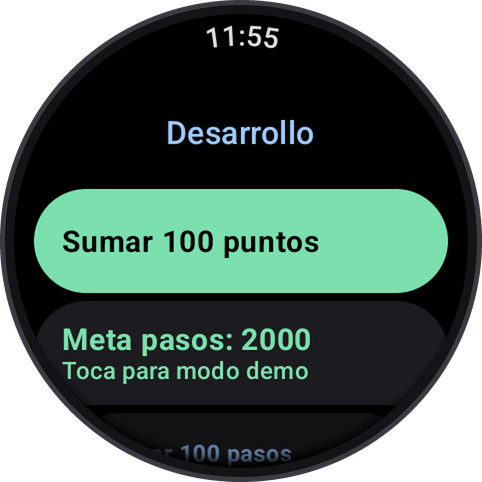

En la pantalla Hoy, **mantén pulsada la insignia de nivel durante 2 segundos**. Se abre una
pantalla con opciones para la demostración:

- **Sumar 100 puntos**: suma experiencia para ver cómo se sube de nivel.
- **Meta pasos: 2000 / 30**: alterna la meta normal y el modo demo, que pide solo 30 pasos
  para mostrar el registro automático caminando unos segundos.
- **Sumar 100 pasos**: suma pasos sin caminar. Sirve en el emulador.
- **Simular día anterior**: mueve todos los registros un día hacia atrás, como si ya fuera
  mañana. Sirve para mostrar cómo crece la racha sin esperar días reales.
- **Reiniciar todo**: borra el progreso.

Las capturas de este README se hicieron así: con *Simular día anterior* se armó una racha de
cinco días, con *Sumar 100 puntos* se subió al nivel 3 y con *Sumar 100 pasos* se llenó la
barra de pasos.

<br clear="right">

## Decisiones de diseño

### Fondo negro puro

El fondo es `#000000` por una razón técnica, no estética. Los relojes usan pantallas OLED,
donde un píxel negro está apagado: no consume energía y la batería dura más. Además, el borde
de la pantalla se pierde contra el marco del reloj y la interfaz parece flotar. Por eso los
colores de acción (menta, ámbar y azul claro) son claros y saturados: sobre negro un color
oscuro desaparece, y un reloj se mira de reojo, muchas veces bajo el sol.

| Color | Uso |
|---|---|
|  | Acción y progreso: botón *Registrar*, anillo, puntos ganados |
|  | Racha y logros |
|  | Nivel y experiencia |

### Páginas horizontales en vez de un menú

En una pantalla de 45 mm, un menú obliga a abrir, leer y elegir: tres pasos para algo que
debería tomar uno. Las páginas horizontales son el patrón nativo de Wear OS: se llega con un
solo gesto y el indicador de arriba dice dónde estás. Tampoco hay barra de navegación inferior,
porque ese patrón es de celular y en una pantalla redonda la parte de abajo casi no tiene
ancho. Para volver se desliza desde el borde izquierdo, que es el gesto del sistema, así que no
hay botones de retroceso propios.

### Listas con `ScalingLazyColumn`

Las listas usan `ScalingLazyColumn`. Los elementos de los extremos se encogen y se desvanecen
siguiendo la curva de la pantalla, de modo que lo que está al centro, que es lo legible, se ve
grande. También responde a la corona giratoria sin código extra. Se nota en la captura de
[Actividades](#pantallas): *Caminar* y *Dormir* se achican en los bordes.

### Pasos con el contador del reloj

La pantalla Pasos usa el contador de pasos de hardware con el permiso `ACTIVITY_RECOGNITION`.
Ese contador lo mantiene el propio reloj y sigue contando aunque la app esté cerrada, así que
no gasta batería extra. Los pasos del día se cuentan desde la primera vez que se abre la app
ese día.

Solo *Caminar* se detecta sola. Las demás actividades (leer, meditar, dormir…) se marcan a
mano: no hay un sensor que las detecte con certeza, y marcarlas refuerza el hábito.

### Otras decisiones

- **Una acción por pantalla y textos cortos.** Ninguna línea pasa de cinco palabras, porque
  quien mira el reloj lo hace durante dos segundos.
- **En Hoy, el nivel y la racha van a los lados del anillo.** El anillo mide 160 dp en
  pantallas grandes y se reduce en las pequeñas. Si el nivel y la racha fueran debajo, el botón
  *Registrar* no cabría en la parte baja de la pantalla redonda.
- **Tres patrones de vibración**: un toque al registrar, dos al cumplir la meta y tres
  ascendentes al desbloquear un logro. En un reloj la vibración es el canal de salida más
  propio, y se entiende sin mirar.
- **Poco movimiento**: los puntos suben contando (600 ms), el anillo se llena (800 ms) y la
  palomita entra con un rebote corto. Nada más se anima.

## Estructura

```
app/src/main/java/com/racha/
├── MainActivity.kt
├── VistaModelo.kt          estado observable (StateFlow), pasos y acciones
├── datos/                  modelos, semilla, repositorio DataStore y podómetro
├── logica/                 niveles, racha y logros: funciones puras
└── ui/                     tema, iconos, vibración, navegación, componentes y pantallas

docs/
├── portada.png             imagen de portada de este README
└── capturas/               capturas de cada pantalla
```

La lógica de `logica/` no depende de Android ni de Compose. Sus pruebas están en
`app/src/test`.
